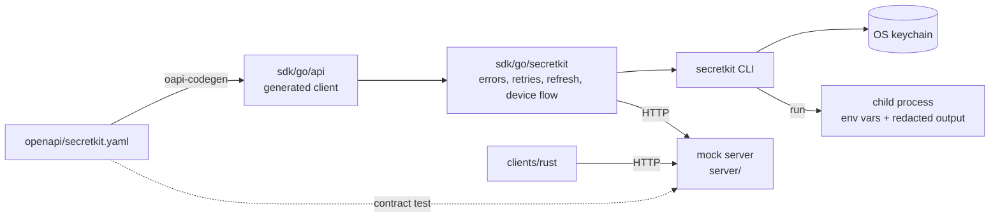
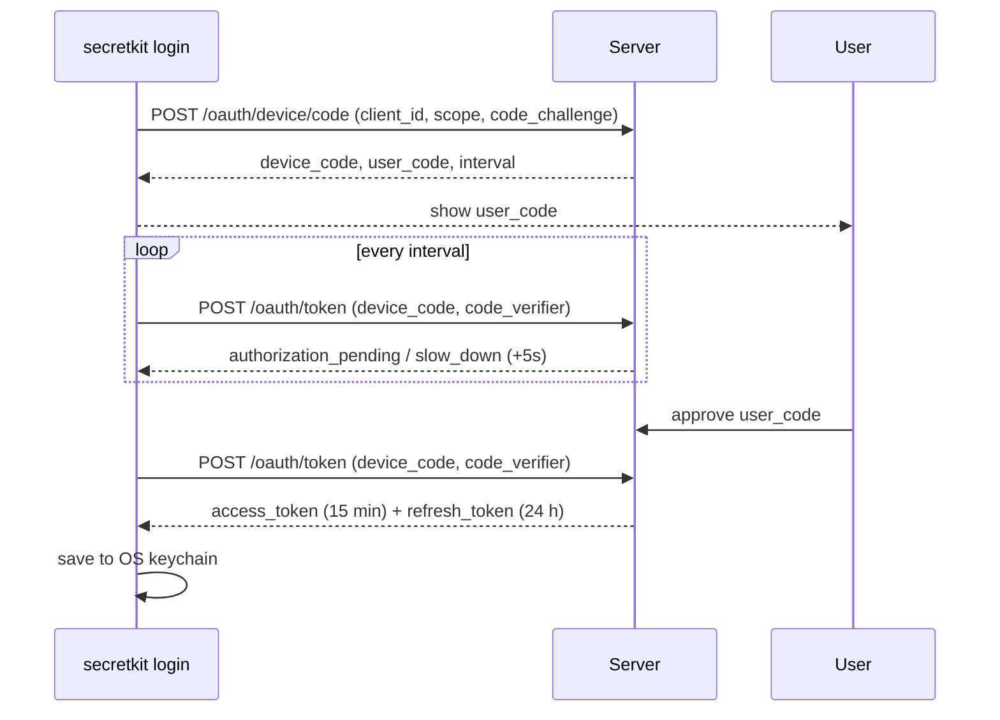

# SecretKit

A secrets CLI and SDK with a local mock server: log in with the OAuth 2.0
device flow, keep tokens in the OS keychain, and run commands with secrets
injected as environment variables, with any secret the command prints
replaced by `[REDACTED]`.

- **`secretkit` CLI** (Go, Cobra): `login`, `logout`, `get`, `set`, `list`,
  `run -- <cmd>`, shell completions, `--version`.
- **Go SDK**: client generated from the OpenAPI spec (oapi-codegen) plus a
  wrapper with typed errors, retries with backoff, token refresh and
  `context` support.
- **Rust client**: token-based `get`/`list` with typed errors.
- **Mock server** (Go, `net/http`, in-memory): device authorization with
  PKCE, short-lived access tokens, rotating refresh tokens, per-token scopes.

Everything follows from [`openapi/secretkit.yaml`](openapi/secretkit.yaml).

## Architecture



```text
openapi/            OpenAPI 3 spec (source of truth)
server/             mock server; cmd/secretkit-server is the binary
sdk/go/api/         generated client (go generate)
sdk/go/secretkit/   hand-written SDK wrapper
cmd/secretkit/      CLI entry point
internal/cli/       CLI commands, keychain storage, end-to-end tests
internal/redact/    streaming secret redaction
clients/rust/       Rust client
bench/              CLI cold-start and SDK latency benchmarks
docs/               design doc and MkDocs site
```

## Quickstart

Requires Go 1.25+. `login` needs an OS keychain (macOS Keychain, Windows
Credential Manager, or a Secret Service provider such as gnome-keyring on
Linux). These are the commands as run on Linux with gnome-keyring.

```bash
go build -o bin/secretkit-server ./server/cmd/secretkit-server
go build -o bin/secretkit ./cmd/secretkit
```

Start the server (listens on `http://127.0.0.1:8787`):

```bash
./bin/secretkit-server
```

In another terminal, log in:

```bash
./bin/secretkit login
```

```text
To log in, open http://127.0.0.1:8787/device?user_code=GRVN-NHVJ
and confirm the code: GRVN-NHVJ
Waiting for approval (expires in 10m0s)...
```

The mock server has no consent page, so approve the printed code with the
endpoint such a page would call:

```bash
curl -X POST -d 'user_code=GRVN-NHVJ&action=approve' http://127.0.0.1:8787/oauth/device/verify
```

```text
Logged in to http://127.0.0.1:8787 (scopes: secrets:read secrets:write)
```

Store, read and use secrets:

```bash
echo 'fake-db-password' | ./bin/secretkit set DB_PASSWORD
./bin/secretkit set API_KEY fake-api-key-123
./bin/secretkit get DB_PASSWORD
./bin/secretkit list
./bin/secretkit run -- sh -c 'echo "DB_PASSWORD has ${#DB_PASSWORD} chars"; echo "API_KEY=$API_KEY"'
./bin/secretkit logout
```

```text
Stored DB_PASSWORD (version 1)
Stored API_KEY (version 1)
fake-db-password
NAME         VERSION  UPDATED
API_KEY      1        2026-10-29T16:15:10Z
DB_PASSWORD  1        2026-10-29T16:15:10Z
DB_PASSWORD has 16 chars
API_KEY=[REDACTED]
Logged out.
```

Without a keychain (CI, containers), give the server a development token
and pass it to the CLI:

```bash
SECRETKIT_DEV_TOKEN=fake-dev-token ./bin/secretkit-server
```

```bash
SECRETKIT_TOKEN=fake-dev-token ./bin/secretkit list
```

Rust client tests (they build and start the Go server):

```bash
cd clients/rust && cargo test
```

More in [docs/quickstart.md](docs/quickstart.md) and
[docs/sdk-usage.md](docs/sdk-usage.md).

## Auth flow

The CLI uses the device authorization grant (RFC 8628) with PKCE (RFC 7636,
S256) bound to the device code:



- Access tokens expire after 15 minutes; the SDK refreshes them 30 seconds
  early, and once more after a `401`.
- Refresh tokens rotate on every use. Reusing an old refresh token revokes
  the whole session. The CLI saves each rotated token to the keychain.
- Scopes: `secrets:read` (list, get) and `secrets:write` (put).
  `secretkit login --scope secrets:read` gives a read-only session.
- `secretkit logout` revokes the session on the server and deletes the
  keychain entry.

Details: [docs/auth-flows.md](docs/auth-flows.md).

## Security notes

What is protected:

- **No tokens or secrets on disk.** Tokens are stored only in the OS
  keychain. If none is available the CLI stops with an error explaining the
  `SECRETKIT_TOKEN` alternative; there is no file fallback.
- **Redaction.** `secretkit run` replaces every fetched secret value (and
  the CLI's own tokens) in the child's stdout and stderr with `[REDACTED]`,
  including values split across output chunks. CLI logs (`--verbose`) go
  through the same filter.
- **No secrets in logs.** The server logs only method, path, status and
  duration. The Rust types print `[REDACTED]` for values and hide tokens in
  `Debug` output.
- **PKCE on the device flow.** A leaked `device_code` cannot be redeemed
  without the verifier held by the CLI process.
- **Refresh token reuse detection**, token hashes (not raw tokens) in server
  memory, `client_id` binding, and `slow_down` enforcement.
- **Child isolation from CLI credentials.** `SECRETKIT_TOKEN` is removed
  from the child's environment.

What is not protected:

- The mock server is for local development: plain HTTP, in-memory storage,
  and an unauthenticated `/oauth/device/verify` endpoint that lets anyone
  who can reach the server approve any pending code. It binds to
  `127.0.0.1` by default.
- Injected secrets are ordinary environment variables: readable by the
  child, its descendants, and other processes of the same user (for
  example via `/proc/<pid>/environ`). The same applies to `SECRETKIT_TOKEN`.
- Redaction only matches exact values. Encoded or transformed values
  (base64, partial prints) and values shorter than 4 bytes are not masked.
  Output written directly to `/dev/tty` or to files bypasses it.
- `secretkit get` prints the value to stdout on purpose.
- Device-flow phishing (an attacker starting a flow and convincing a user to
  approve the attacker's code) is inherent to the grant.

Full threat model: [docs/design.md](docs/design.md#threat-model).

## Benchmarks

Measured with
`go test -run '^$' -bench . -benchmem -count 5 ./bench/ ./internal/redact/`
on an Intel Xeon @ 2.10GHz with 4 vCPUs, 15 GiB RAM, Ubuntu 24.04.5 (cloud
container), go1.25.3. Median of 5 runs, min–max in parentheses. Copied from
[docs/benchmarks.md](docs/benchmarks.md), which has the raw output.

CLI cold start (new process per iteration, local server, `SECRETKIT_TOKEN` auth):

| Command | Mean | p50 | p99 |
|---|---|---|---|
| `secretkit --version` | 3.86 ms (3.79–4.15) | 3.72 ms (3.64–3.92) | 5.67 ms (4.75–6.37) |
| `secretkit get SECRET_001` | 4.94 ms (4.60–5.04) | 4.69 ms (4.45–4.83) | 7.86 ms (6.40–8.32) |
| `secretkit run -- true` (10 secrets) | 9.23 ms (8.73–9.63) | 9.09 ms (8.55–9.31) | 12.48 ms (11.50–13.82) |

SDK request latency (warm connection, loopback):

| Operation | Mean | p50 | p99 |
|---|---|---|---|
| `GetSecret` | 101 µs (93–114) | 88 µs (83–98) | 324 µs (281–340) |
| `PutSecret` | 124 µs (120–131) | 107 µs (104–113) | 375 µs (353–410) |
| `ListSecrets` (100 secrets) | 451 µs (418–453) | 410 µs (380–419) | 1116 µs (1036–1273) |
| `GetSecret`, 4 goroutines | 33 µs per op (29–34) | – | – |

Redaction writer: 1050 MB/s (934–1055), 0 allocations per write.

## Development

```bash
go test -race ./...
go vet ./...
golangci-lint run ./...
cd clients/rust && cargo clippy --all-targets -- -D warnings && cargo test
```

The tests cover the device-flow state machine, PKCE (including the RFC 7636
test vector), token refresh and reuse detection, redaction (including every
possible split point of a stream), SDK error mapping and retries, and an
end-to-end CLI test that starts the server, logs in by auto-approving the
device code, sets and gets secrets, and runs `secretkit run` with env
injection. Server responses are validated against the OpenAPI spec.

After changing the spec, regenerate the Go client:

```bash
cd sdk/go/api && go generate
```

Docs site: `pip install -r docs/requirements.txt && mkdocs serve`.

CI (`.github/workflows/ci.yml`) runs `go vet`, `go test -race`,
golangci-lint, a generated-code check, cross-compilation for all release
targets, `cargo fmt`, `cargo clippy`, `cargo test` and `mkdocs build
--strict`. Pushing a `v*` tag runs GoReleaser (`.goreleaser.yaml`) to
publish `secretkit` archives for Linux, macOS and Windows on amd64 and arm64.

## Limitations

- The server is a mock: single tenant, in-memory, no persistence, no TLS,
  and no real user login behind device approval.
- The Rust client only reads secrets with an existing token. It does not
  log in, refresh tokens, write secrets or retry.
- `secretkit run` pipes the child's stdout and stderr to redact them, so the
  child does not see a terminal on those streams (no colours or progress
  bars from TTY-aware programs).
- Redaction holds back output that could be the start of a secret until
  more output arrives or the stream ends. A program that prints such a
  prefix and then waits for input appears to stall.
- While a child runs, the CLI forwards SIGINT and SIGTERM to it. A Ctrl-C in
  a terminal also reaches the child directly, so it may see SIGINT twice.
- `secretkit run` fetches secrets one request at a time (one list plus one
  get per secret).
- On Linux, keychain access needs a running Secret Service (for example
  gnome-keyring on a D-Bus session).
- Tested locally on Linux only. macOS and Windows binaries are
  cross-compiled in CI but have not been run.
- The GoReleaser config has not been run yet (it runs on the first `v*`
  tag); the same build targets are cross-compiled on every CI run.
