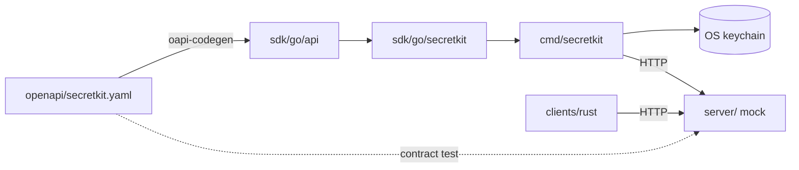
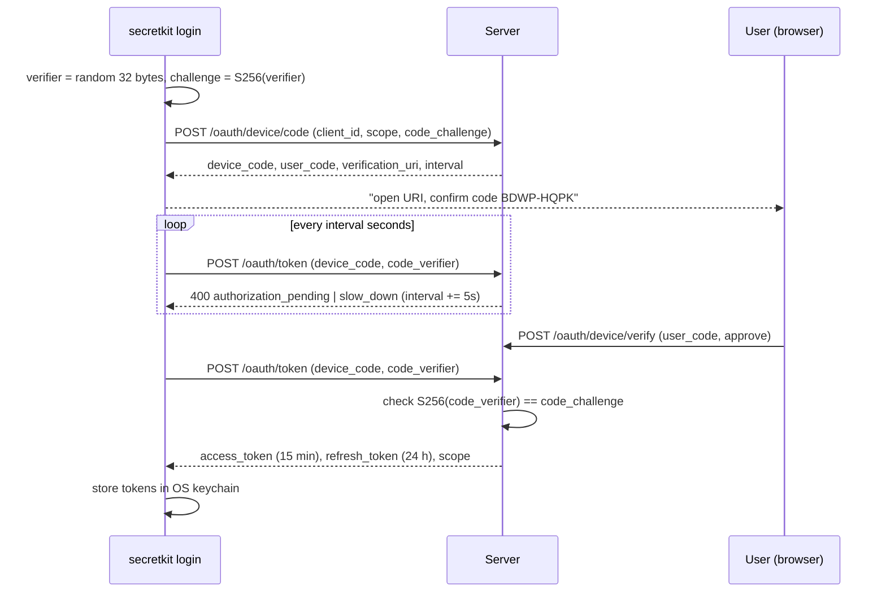

# Design

## Problem

Developers need secrets (database passwords, API keys) in local processes
and CI jobs. The common workarounds are `.env` files checked into or left on
disk, long-lived tokens pasted into shell profiles, and secrets printed into
build logs. SecretKit is a small, end-to-end example of doing this more
carefully:

- log in from a terminal without typing a password into it (device flow);
- keep credentials in the OS keychain, never in files;
- hand secrets to a process as environment variables at start-up;
- mask secret values if the process prints them.

The server in this repository is an in-memory mock written for local
development and tests. It is not a production secrets store.

## Components



| Path | Role |
|---|---|
| `openapi/secretkit.yaml` | Source of truth for the API. |
| `server/` | Mock server: device flow, PKCE, tokens, scopes, secrets. |
| `sdk/go/api` | Client generated from the spec. Not edited by hand. |
| `sdk/go/secretkit` | Wrapper: typed errors, retries, token refresh, device flow. |
| `internal/cli`, `cmd/secretkit` | The CLI. |
| `internal/redact` | Streaming redaction used by the CLI. |
| `clients/rust` | Read-only Rust client using an existing access token. |

## Auth flow

The CLI uses the OAuth 2.0 Device Authorization Grant (RFC 8628). PKCE
(RFC 7636, S256) is added on top: the challenge is sent with the device code
request and the verifier with every token poll.



Device request lifecycle on the server (`server/device.go`):

```text
pending --approve--> approved --poll with matching verifier--> tokens issued, request deleted
pending --deny-----> denied   --poll--> access_denied, request deleted
approved --poll with wrong verifier--> invalid_grant, request deleted
any state, after expires_in --poll--> expired_token, request deleted
poll sooner than interval --> slow_down, interval += 5s
```

Refresh tokens rotate. Every login starts a token *family*; each refresh
marks the presented refresh token as used and issues a new pair in the same
family. Presenting a used refresh token revokes the entire family, because
it means two parties hold the same token.

## Threat model

**Assets:** secret values; access and refresh tokens; in-flight device
codes and PKCE verifiers.

**Trusted:** the local user account and OS keychain; the server.

| Threat | Mitigation | Residual risk |
|---|---|---|
| Tokens read from disk (backups, dotfiles, other tools) | Tokens are only stored in the OS keychain. If no keychain is available the CLI fails with an explicit error instead of falling back to a file. | `SECRETKIT_TOKEN` (the no-keychain option) is visible to other processes of the same user, e.g. via `/proc/<pid>/environ`. |
| Secrets or tokens in logs | Server logs only method, path, status and duration. CLI logs go through the same redaction filter as child output and only log names/versions. Rust `Debug` impls hide values and tokens. | A value transformed before printing (base64, reversed, split across lines with other text between) is not recognised. |
| Child process prints a secret | `secretkit run` redacts all fetched values (and the CLI's tokens) from the child's stdout/stderr, including values split across write boundaries. | Values shorter than 4 bytes are not redacted. Output written directly to `/dev/tty` or to files bypasses the filter. |
| Child process reuses the CLI's credentials | `SECRETKIT_TOKEN` is removed from the child environment; keychain tokens are never placed in the environment. | The child can still read the injected secrets, by design. |
| Intercepted `device_code` (logs, proxies) | PKCE: redeeming needs the verifier, which never leaves the CLI process before the token request. A wrong verifier presented after approval deletes the request, so it cannot be guessed repeatedly. | Does not stop remote phishing where an attacker starts a flow and convinces a user to approve the attacker's code. That is inherent to the device grant. |
| Stolen refresh token | Rotation with reuse detection revokes the whole session on the next refresh by either party. Refresh tokens are bound to `client_id`. | The thief can use the token until the legitimate client refreshes. |
| Aggressive polling / brute force | `slow_down` with a growing interval; user codes are 8 characters from a 20-letter alphabet (20^8 ≈ 2.6 × 10^10) and expire after 10 minutes. Optional per-caller rate limit. | Rate limiting is off by default in the mock. |
| Server memory dump | The server stores SHA-256 hashes of tokens and device codes, not the raw values. | Secret values themselves are stored in plain memory. |

**Explicitly not protected (mock server):** the `/oauth/device/verify`
endpoint has no user authentication, so anyone who can reach the server can
approve any pending code; the server speaks plain HTTP and keeps everything
in memory. It binds to `127.0.0.1` by default for that reason. A root or
same-user attacker on the client machine is out of scope.

## Decisions and tradeoffs

**Spec first, generated client, hand-written server.** The client is
generated with oapi-codegen so it cannot drift from the spec. The server is
hand-written because the OAuth endpoints are form-encoded and the device
state machine is clearer as plain code; instead of generating it, a contract
test (`server/server_test.go`) sends every request through kin-openapi and
fails if a request or response does not match the spec.

**PKCE on the device grant.** RFC 8628 does not require PKCE. It is added
here because the device code is a bearer credential while the flow is
pending; binding it to a verifier held only by the initiating process means
an observer of the device code cannot redeem it.

**Retry policy.** The SDK retries `429` on any method (the server did not
process the request) but retries `5xx` and transport errors only on
idempotent methods. Retrying `POST /oauth/token` after a `5xx` could replay
a refresh token that the server already rotated and trigger reuse detection.
Backoff is exponential (100 ms base, 20% jitter, capped at 5 s) and honours
`Retry-After`.

**Refresh inside the SDK, persistence in the caller.** The SDK refreshes
access tokens 30 s before expiry and once more on a `401`. Because refresh
tokens rotate, the CLI persists every new token pair to the keychain via a
callback; otherwise the next process would present a used refresh token and
revoke its own session. `TestEndToEndRefreshPersistsRotatedToken` covers
this.

**Keychain only.** A plaintext file fallback would make the "never write
secrets to disk" rule false on exactly the machines (headless Linux, CI)
where it matters most. Instead those environments use `SECRETKIT_TOKEN`.

**Secret names are environment variable names.** Names are restricted to
`[A-Za-z_][A-Za-z0-9_]{0,127}` so `secretkit run` can inject them without a
mapping step, and so names are always safe in URL paths.

**Redaction holds back output.** The redacting writer withholds the tail
of the stream while it could still be the start of a secret, and flushes
it when the stream ends. This is what makes redaction work across chunk
boundaries, but a child that prints part of a secret's prefix and then waits
for input will appear to hang until more output arrives. Secrets shorter
than 4 bytes are skipped because masking values like `1` or `true` would
destroy unrelated output.

**Child output is piped.** To redact, the child's stdout and stderr are
pipes, not the terminal. Programs that change behaviour when not attached
to a TTY (colours, progress bars, interactive prompts) will behave as if
their output were redirected.

**Signals.** While a child runs, SIGINT and SIGTERM received by the CLI are
forwarded to it, and the CLI exits with the child's status. A Ctrl-C in a
terminal reaches both processes, so the child may see SIGINT twice.
